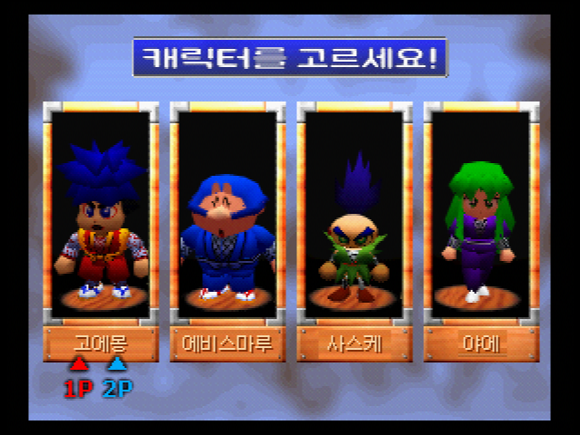
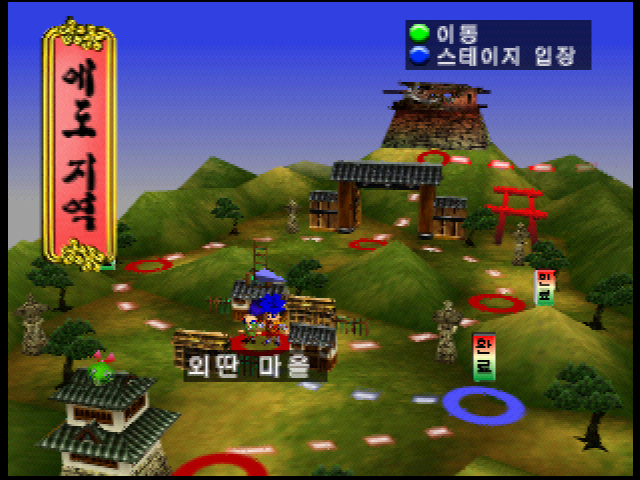
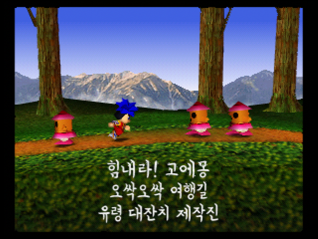
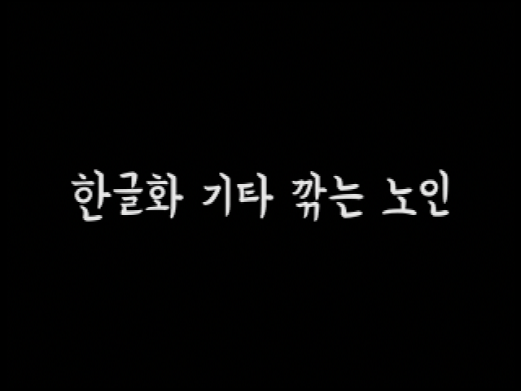

# 힘내라! 고에몽 — 비공식 한글화 v1.0 정식 버전

**오싹오싹 여행길 유령 대잔치 · Nintendo 64 일본판 한국어 패치**

원작: **がんばれゴエモン でろでろ道中 オバケてんこ盛り** 
한글화: **기타 깎는 노인** 
배포일: **2026-10-26**

## 다운로드

**[v1.0 정식 버전 다운로드](https://github.com/OldManCraveGuitars-bit/N64-Ganbare-Goemon-Derodero-Dochu-Obake-Tenko-Mori-Kr/releases/tag/v1.0)**

- **Windows EXE 패처**: Python이나 별도 패치 프로그램 없이 실행합니다.
- **Windows ZIP**: 패처, BPS 패치, 사용법, 에뮬레이터 설정 안내를 함께 제공합니다.
- **BPS 단독 패치**: 일반 BPS 프로그램을 사용하는 경우 big endian `.z64` 원본에 적용합니다.
- **Screenshots-v1.0.zip**: 아래 인게임 스크린샷 모음입니다.
- **SHA256SUMS.txt**: 배포 파일의 SHA256 목록입니다.

게임 원본과 패치 완료 롬은 포함하지 않습니다. 별도로 준비한 일본판 원본이 필요합니다.

## 적용 방법

1. EXE 패처를 실행합니다.
2. 일본판 원본 `.z64`, `.v64` 또는 `.n64`를 선택합니다. 바이트 순서는 자동 판별합니다.
3. 새 출력 파일 경로를 고르고 **한글 패치 적용**을 누릅니다.
4. 결과 SHA256 검증이 완료되면 생성된 `.z64` 롬을 부팅합니다.

원본은 **16 MiB**, 결과는 **32 MiB**입니다. 원본 및 기존 출력 파일은 덮어쓰지 않습니다. 크기가 늘어난 것은 한글 글꼴·그림·대사 데이터를 넣고 N64 롬 크기에 맞춰 정렬했기 때문입니다.

에뮬레이터는 원본 게임과 같은 **CountPerOp 1 · SRAM · 2인** 설정을 사용하세요. 체크섬이 바뀌면 원본의 자동 설정이 적용되지 않는 코어가 있습니다. 함께 제공하는 `에뮬레이터-설정.txt`를 참고하세요.

다른 패치 버전의 세이브스테이트 대신 **게임 내 저장 데이터**를 사용하세요.

## 한글화 내용

- 일본어 대사·이벤트 문구·메뉴와 가사 자막을 한국어로 표시합니다.
- 대사의 띄어쓰기에 반각 공백을 사용합니다.
- 간판, 통행증 표시, 캐릭터 이름, 게임 오버, 스테이지 클리어 등의 그림 글씨를 수정했습니다.
- 로봇전의 돈·연료 표시와 적 이름 위치, 선택지 정렬, 대사창 넘침·이름/얼굴 가림을 보정했습니다.
- 제작진 크레딧을 붓글씨 느낌의 연성체로 정리하고 마지막에 **한글화 기타 깎는 노인**을 넣었습니다.
- NPC 대화 시작 대기와 마지막 로봇전 패배 후 파일 읽기 대기 처리를 보완했습니다.
- 기존 영문 표시와 `OK`, 영문 로고·저작권 표시는 유지합니다.

## 해시

패처가 확인하는 원본은 아래 **정규화된 `.z64`**입니다. EXE는 `.v64/.n64`도 정규화한 뒤 같은 해시를 검사합니다.

| 대상 | SHA256 |
| --- | --- |
| 일본판 원본 `.z64` — 16 MiB | `d42e0fcdcc11678f17cd1977f9b774981923bfca22a989d73d7989b09d25bdd8` |
| v1.0 결과 `.z64` — 32 MiB | `5205295d9e14a49219fcdb0b65965a28eaf9103eb8faefab2f6bcc00291558fb` |
| Windows EXE | `173a833956c9ad86a3c1d86e060da4d82561f492df47b4011c4e79577600ee5d` |
| BPS 패치 | `4da7695fc56bbef45f589a11b75baa271c5617fec888d2370c0e2b222050e9dd` |

원본 정규화 **SHA1**: `2ab71b71665a688d40832e16d897548ece9f0dd4`

배포 ZIP 등의 해시는 [SHA256SUMS.txt](SHA256SUMS.txt), 상세 원본·결과 정보는 [data/manifest.json](data/manifest.json)에 있습니다.

## 인게임 스크린샷

아래 화면은 v1.0 결과 롬을 에뮬레이터에서 실행해 캡처했습니다. 화면 비율은 4:3입니다.

캐릭터 선택

지역 지도

제작진 크레딧

마지막 한글화 문구

## 확인 범위와 제보

대사 4,991구간과 반각 공백 28,915개, 제작진 카드 30장의 데이터 로딩·출력 범위를 검사했습니다. 최신 결과 롬의 새 부팅, 캐릭터 선택, 지도, 크레딧 실화면을 확인했습니다. 엔딩 캡처는 장면 진입과 진행을 검수용으로 앞당겼으며, 전체 플레이 분기를 전수 완주했다는 뜻은 아닙니다.

배포 EXE로 세 가지 바이트 순서를 실제 적용해 같은 결과 해시가 나오는지 확인했습니다. 원본/기존 출력 보존과 잘못된 원본·손상된 패치 차단도 시험했습니다. 결과는 [검증 기록](docs/validation.json)에 있습니다.

작고 판독이 어려운 일부 배경 표시·장식은 원문을 유지했습니다. 누락이나 배치 문제가 보이면 **스크린샷, 진행 위치, 사용한 에뮬레이터/코어**를 [Issues](https://github.com/OldManCraveGuitars-bit/N64-Ganbare-Goemon-Derodero-Dochu-Obake-Tenko-Mori-Kr/issues)로 알려 주세요.

## 패처 소스

소스 실행: `python patcher_app.py` 
Windows EXE 빌드: `python -m pip install -r requirements-build.txt` 후 `scripts/build_exe.ps1` 실행

이 저장소에는 패처 소스와 패치 데이터만 있습니다. 게임 원본, 완성 롬, 개인 저장 파일은 배포하지 않습니다. 게임의 권리는 원 권리자에게 있습니다.
